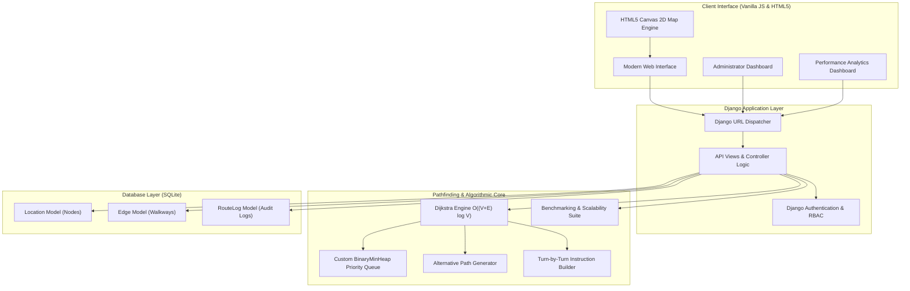
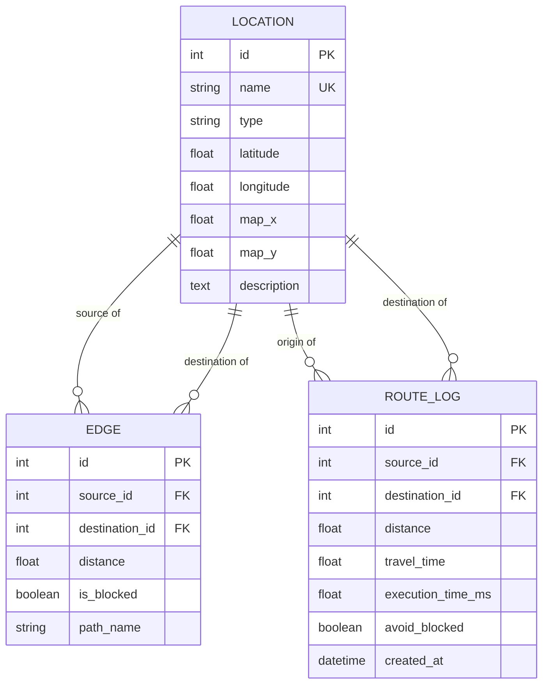

# Campus Navigation & Smart Routing System

[](https://www.python.org/)
[](https://www.djangoproject.com/)
[](#17-how-to-execute-tests)
[](#10-complexity-analysis)
[](LICENSE)

An enterprise-grade, full-stack campus navigation system built with **Django**, an array-backed **Binary Min-Heap Priority Queue**, and an interactive, responsive **HTML5 Canvas** rendering engine. Computes optimal walking paths, generates step-by-step turn instructions, handles dynamic edge blockages with instant re-routing, and includes a full administrator dashboard and a quantitative algorithm benchmarking suite.

---

## Table of Contents

1. [Project Overview](#1-project-overview)
2. [Problem Statement](#2-problem-statement)
3. [Solution Architecture](#3-solution-architecture)
4. [Key Features](#4-key-features)
5. [Technology Stack](#5-technology-stack)
6. [System Architecture Diagram](#6-system-architecture-diagram)
7. [Graph Representation](#7-graph-representation)
8. [Dijkstra's Algorithm Implementation](#8-dijkstras-algorithm-implementation)
9. [Custom Binary Min-Heap Priority Queue](#9-custom-binary-min-heap-priority-queue)
10. [Complexity Analysis](#10-complexity-analysis)
11. [REST API Documentation](#11-rest-api-documentation)
12. [Database Schema](#12-database-schema)
13. [Installation & Setup](#13-installation--setup)
14. [Environment Configuration](#14-environment-configuration)
15. [How to Add & Manage Campus Data](#15-how-to-add--manage-campus-data)
16. [How to Run the Application](#16-how-to-run-the-application)
17. [How to Execute Tests](#17-how-to-execute-tests)
18. [How to Execute Benchmarks](#18-how-to-execute-benchmarks)
19. [Measured Benchmark Results](#19-measured-benchmark-results)
20. [Deployment Recommendations](#20-deployment-recommendations)

---

## 1. Project Overview

University campuses, corporate business parks, and hospital complexes feature intricate pedestrian networks: walkways, plazas, skybridges, service roads, and restricted construction zones. Commercial navigation systems (like GPS-based automotive maps) frequently fail in these environments due to poor indoor-outdoor pedestrian mapping, lack of walkway resolution, and inability to handle dynamic pathway closures.

**Campus Navigation System** resolves this by modeling university infrastructure as a weighted, bidirectional graph backed by an SQLite relational database. Routing calculations utilize an optimized implementation of Dijkstra's algorithm powered by a custom binary min-heap priority queue achieving strict $\mathcal{O}((V + E) \log V)$ time complexity.

---

## 2. Problem Statement

1. **Pedestrian vs. Vehicular Topography**: Campuses rely on pedestrian walkways that do not conform to public road grids. Navigation requires meter-accurate physical path lengths and accessible path classification.
2. **Dynamic Pathway Blockages**: Campuses frequently experience construction, maintenance, events, or inclement weather that block paths. The system must dynamically recalculate alternative routes in real time without corrupting concurrent user sessions.
3. **Data Authenticity**: Mini-projects often rely on hardcoded mockup arrays. A production system must separate actual campus topography from synthetic test graphs, display graceful empty states when map data is pending, and provide a secure administrative portal for facility managers.
4. **Algorithmic Rigor & Quantifiable Performance**: Production deployments require measurable performance validation (execution latency, memory allocation, percentile distributions, scalability) across graph sizes up to $10,000$ vertices.

---

## 3. Solution Architecture

The application adopts a modular layered architecture:

- **Data Layer**: Django ORM with SQLite database storing verified `Location`, `Edge` (pathways), and `RouteLog` records. All schema mutations are protected with atomic transactions.
- **Algorithm Engine (`navigation.utils.graph`)**: Custom `BinaryMinHeap` priority queue, Dijkstra shortest-path calculator, edge-weight validator, disconnected graph handler, and alternative route generator.
- **Instruction Generator (`navigation.utils.instructions`)**: Converts graph nodes and edge bearing vectors into intuitive, non-technical turn-by-turn walking steps.
- **RESTful API Layer (`navigation.views`)**: Structured JSON endpoints providing graph data, route computations, pathway block toggling, and benchmark statistics.
- **Frontend Presentation Layer**: Vanilla HTML5, modern CSS3 (Google Maps / SaaS inspired design system), and an interactive HTML5 Canvas engine with pan, zoom, hover tooltips, and Dijkstra step-by-step replay.
- **Benchmarking Suite (`navigation.benchmark`)**: Automated benchmarking harness measuring microsecond latencies across real campus graphs and synthetic planar graphs from $100$ to $10,000$ vertices.

---

## 4. Key Features

- **Optimal Walking Routes**: Shortest path computation by physical distance (meters) and walking duration (estimated at $1.2\text{ m/s}$ / $4.32\text{ km/h}$).
- **Turn-by-Turn Directions**: Generates directions using geometric vector bearings and junction angles (e.g., *"Walk 140m north along Scholars Walk toward University Library"*).
- **Dynamic Pathway Blocking & Rerouting**: Administrators can block walkways; new route queries automatically discover viable alternatives without rebuilding the entire graph state.
- **Genuine Alternative Routes**: Automatically detects and displays divergent alternative routes if available.
- **High-DPI HTML5 Canvas Map**: Smooth drag-to-pan, wheel zoom, zoom controls ($+$, $-$, Reset), node hover cards, and path highlighting.
- **Dijkstra Priority Queue Visualizer**: Interactive step-by-step algorithm replay with play/pause/step controls showing priority queue state.
- **Full Administrator Management Dashboard**: Web interface for adding, editing, and deleting campus locations and walkways, with cascade safety checks.
- **Performance Analytics Dashboard**: Live charts displaying empirical execution latency distributions and scalability curves up to $10,000$ vertices.
- **Strict Data Integrity**: Zero hardcoded mock buildings. Fresh installations display a clean empty state: *"No campus map data is available yet. Please contact the campus administrator."*

---

## 5. Technology Stack

- **Backend**: Python 3.10+ / 3.14, Django 4.2+ / 6.0, `django-cors-headers`
- **Database**: SQLite (configured outside OneDrive sync roots to eliminate cloud-sync file locks)
- **Frontend**: Vanilla JavaScript (ES6+), HTML5 Canvas 2D API, CSS3
- **Data Structures**: Custom array-backed Binary Min-Heap Priority Queue, Adjacency List Graph
- **Testing & QA**: Django Test Framework, Python `unittest`, `tracemalloc` for memory profiling

---

## 6. System Architecture Diagram



---

## 7. Graph Representation

The campus network is represented as an **Adjacency List**:

$$\mathcal{G} = (\mathcal{V}, \mathcal{E})$$

Where $\mathcal{V}$ is the set of registered campus locations (nodes) and $\mathcal{E}$ is the set of directed, weighted edges connecting them. Because campus walkways are typically pedestrian in both directions, each physical pathway between location $A$ and location $B$ with distance $w$ is represented by two directed edges:

$$(u, v, w, \text{edge\_id}) \quad \text{and} \quad (v, u, w, \text{edge\_id})$$

```python
# Adjacency list structure:
adjacency: Dict[int, List[Tuple[int, float, int]]] = {
    location_id: [(neighbor_id, distance_meters, edge_id), ...]
}
```

### Graph Validation Rules
1. **Positive Weights**: Distance $w > 0.0$ meters. Non-positive edge weights raise a `ValueError`.
2. **Self-Loop Prevention**: Edges where $u = v$ are rejected during creation.
3. **Duplicate Edge Handling**: If multiple pathways exist between the same node pair, the minimum-weight pathway is traversed.
4. **Cache Invalidation**: Dynamic edge blocking increments an atomic graph version counter, guaranteeing that concurrent workers read updated network topology.

---

## 8. Dijkstra's Algorithm Implementation

Dijkstra's algorithm computes the shortest path from a source vertex $s$ to a target vertex $t$ on a weighted directed graph with non-negative edge weights.

### Pseudocode

```text
Algorithm Dijkstra(Graph G, Source s, Target t):
    Initialize distances[v] = infinity for all v in V
    distances[s] = 0
    previous[v] = None for all v in V
    visited = empty set

    Insert (0, s) into BinaryMinHeap PQ

    While PQ is not empty:
        (current_distance, u) = PQ.pop()

        If u in visited:
            Continue
        Add u to visited

        If u == t:
            Break  // Early exit on destination arrival

        If current_distance > distances[u]:
            Continue  // Skip stale heap entry

        For each neighbor v of u with weight w:
            new_distance = current_distance + w
            If new_distance < distances[v]:
                distances[v] = new_distance
                previous[v] = u
                PQ.push(new_distance, v)  // Relaxation

    If t not in distances:
        Raise NoPathException("No navigable path exists")

    Reconstruct path by walking backwards from t using previous map
    Return path, distances[t]
```

---

## 9. Custom Binary Min-Heap Priority Queue

To achieve optimal performance without relying on exterior libraries, the engine includes an array-backed **Binary Min-Heap** (`navigation.utils.graph.BinaryMinHeap`).

### Heap Properties & Array Mapping
For any zero-indexed element at position $i$:
- **Left Child**: $2i + 1$
- **Right Child**: $2i + 2$
- **Parent**: $\lfloor(i - 1) / 2\rfloor$
- **Min-Heap Invariant**: $A[\text{parent}(i)] \le A[i]$ for all $i > 0$.

### Core Operations

```python
class BinaryMinHeap:
    def push(self, priority: float, item: int) -> None:
        """Appends item to array and sifts up in O(log V) time."""
        self._heap.append((priority, item))
        self._sift_up(len(self._heap) - 1)

    def pop(self) -> Tuple[float, int]:
        """Extracts root minimum in O(log V) by moving last element to root and sifting down."""
        min_entry = self._heap[0]
        last_entry = self._heap.pop()
        if self._heap:
            self._heap[0] = last_entry
            self._sift_down(0)
        return min_entry
```

- **Sift-Up**: Recursively swaps element with its parent while element priority is smaller than parent.
- **Sift-Down**: Recursively swaps element with the smaller of its two children until the heap property is restored.

---

## 10. Complexity Analysis

| Operation | Custom Binary Min-Heap | Unsorted Array Baseline | Fibonacci Heap |
| :--- | :--- | :--- | :--- |
| **Insert / Push** | $\mathcal{O}(\log V)$ | $\mathcal{O}(1)$ | $\mathcal{O}(1)$ |
| **Extract-Min / Pop** | $\mathcal{O}(\log V)$ | $\mathcal{O}(V)$ | $\mathcal{O}(\log V)$ |
| **Decrease-Key** | $\mathcal{O}(\log V)$ (Lazy) | $\mathcal{O}(1)$ | $\mathcal{O}(1)$ amortized |
| **Dijkstra Total Time** | $\mathbf{\mathcal{O}((V + E) \log V)}$ | $\mathcal{O}(V^2)$ | $\mathcal{O}(E + V \log V)$ |
| **Space Complexity** | $\mathbf{\mathcal{O}(V)}$ | $\mathcal{O}(V)$ | $\mathcal{O}(V)$ |

### Formal Proof of $\mathcal{O}((V + E) \log V)$
1. Each of the $V$ vertices is extracted from the min-heap at most once: $V \times \mathcal{O}(\log V) = \mathcal{O}(V \log V)$.
2. For each vertex extracted, all its outgoing edges are scanned. In total across all iterations, at most $E$ edges are relaxed.
3. Each successful relaxation operation performs an insert (`push`) into the binary heap: $E \times \mathcal{O}(\log V) = \mathcal{O}(E \log V)$.
4. Combining vertex extractions and edge relaxations gives a total execution bound of $\mathcal{O}((V + E) \log V)$.
5. In a typical planar campus network where $E \le 4V$, the complexity simplifies to $\mathcal{O}(V \log V)$.

---

## 11. REST API Documentation

All endpoints return uniform JSON responses. Error responses never expose internal stack traces.

### Endpoints Summary

| Method | Endpoint | Authorization | Description |
| :--- | :--- | :--- | :--- |
| `GET` | `/api/locations/` | Public | List all campus locations. Supports `?q=<term>` and `?type=<cat>`. |
| `POST` | `/api/locations/` | Administrator | Create a new campus location. |
| `GET` | `/api/locations/<id>/` | Public | Retrieve single location details. |
| `PUT` | `/api/locations/<id>/` | Administrator | Update location coordinates, type, or description. |
| `DELETE` | `/api/locations/<id>/` | Administrator | Delete location and cascades connected pathways. |
| `GET` | `/api/edges/` | Public | List all directed pathways with distance and block status. |
| `POST` | `/api/edges/` | Administrator | Create a new bidirectional pathway between two nodes. |
| `DELETE` | `/api/edges/<id>/` | Administrator | Delete a pathway and its reverse direction edge. |
| `GET` | `/api/campus-graph/` | Public | Full network payload `{locations, edges, stats, graph_version}` for Canvas. |
| `POST` | `/api/find-path/` | Public | Compute shortest path, turn instructions, and alternative routes. |
| `POST` | `/api/toggle-block/` | Public / Admin | Mark a pathway as BLOCKED or RESTORED in both directions. |
| `POST` | `/api/visualize/` | Public | Generate step-by-step trace of Dijkstra queue state. |
| `GET` | `/api/recent-activity/` | Public | List recent route calculation audit logs. |
| `GET` | `/api/benchmark-results/`| Public | Fetch saved benchmark report for the Analytics Dashboard. |
| `POST` | `/api/run-benchmarks/` | Public / Admin | Trigger live benchmark execution and refresh report. |

### Example: Path Calculation Request & Response

#### Request
```http
POST /api/find-path/
Content-Type: application/json

{
  "source_id": 1,
  "destination_id": 6,
  "avoid_blocked": true
}
```

#### Response
```json
{
  "path": [
    {"id": 1, "name": "North Gate", "type": "gate", "lat": 28.6139, "lng": 77.2090, "x": 0.10, "y": 0.85},
    {"id": 2, "name": "Administration Hall", "type": "building", "lat": 28.6145, "lng": 77.2080, "x": 0.25, "y": 0.70},
    {"id": 3, "name": "University Library", "type": "building", "lat": 28.6152, "lng": 77.2070, "x": 0.40, "y": 0.65},
    {"id": 4, "name": "Computer Science Wing", "type": "building", "lat": 28.6160, "lng": 77.2055, "x": 0.55, "y": 0.70},
    {"id": 16, "name": "Faculty Research Center", "type": "building", "lat": 28.6166, "lng": 77.2060, "x": 0.60, "y": 0.55},
    {"id": 6, "name": "Mechanical Engineering", "type": "building", "lat": 28.6175, "lng": 77.2030, "x": 0.85, "y": 0.65}
  ],
  "distance": 710.0,
  "time": 591.7,
  "time_minutes": 9.9,
  "walking_speed_mps": 1.2,
  "edge_count": 5,
  "steps": [
    {"step": 1, "instruction": "Start at North Gate.", "distance": 0.0, "from": "North Gate", "to": "North Gate", "action": "start"},
    {"step": 2, "instruction": "Walk 120m south along North Boulevard toward Administration Hall.", "distance": 120.0, "from": "North Gate", "to": "Administration Hall", "action": "walk"},
    {"step": 3, "instruction": "Turn right 140m southwest along Scholars Walk toward University Library.", "distance": 140.0, "from": "Administration Hall", "to": "University Library", "action": "walk"},
    {"step": 4, "instruction": "Turn right 130m northwest along Academic Corridor toward Computer Science Wing.", "distance": 130.0, "from": "University Library", "to": "Computer Science Wing", "action": "walk"},
    {"step": 5, "instruction": "Turn left 90m southeast along Innovation Walk toward Faculty Research Center.", "distance": 90.0, "from": "Computer Science Wing", "to": "Faculty Research Center", "action": "walk"},
    {"step": 6, "instruction": "Turn left 230m northwest along Research Corridor to Mechanical Engineering. Arrive at your destination.", "distance": 230.0, "from": "Faculty Research Center", "to": "Mechanical Engineering", "action": "arrive"}
  ],
  "metrics": {
    "execution_time_ms": 1.250,
    "nodes_visited": 14,
    "edges_examined": 42,
    "pq_operations": 56,
    "relaxations": 18,
    "queue_type": "BinaryMinHeap"
  },
  "graph_version": 1,
  "success": true
}
```

---

## 12. Database Schema



- **Location**: Campus vertices. Coordinates `map_x` and `map_y` are normalized in $[0.0, 1.0]$ for Canvas responsiveness.
- **Edge**: Directed walkways with a database `UniqueConstraint(fields=['source', 'destination'])`. Bidirectional walkways are modeled as pair records.
- **RouteLog**: Audit trail recording actual navigation calculations, distance, travel duration, and algorithm latency.

---

## 13. Installation & Setup

### Prerequisites
- Python 3.10, 3.11, 3.12, or 3.14
- Git

### Installation Steps

1. **Clone Repository**:
   ```bash
   git clone <repository_url>
   cd campus-navigation-project
   ```

2. **Create & Activate Virtual Environment**:
   ```bash
   python -m venv .venv
   # Windows PowerShell:
   .venv\Scripts\Activate.ps1
   # Linux / macOS:
   source .venv/bin/activate
   ```

3. **Install Dependencies**:
   ```bash
   pip install -r requirements.txt
   ```

4. **Run Database Migrations**:
   ```bash
   python manage.py migrate
   ```

---

## 14. Environment Configuration

Copy `.env.example` to `.env` (optional in development; defaults are pre-configured):

```bash
cp .env.example .env
```

| Variable | Default Value | Purpose |
| :--- | :--- | :--- |
| `DJANGO_SECRET_KEY` | Development key | Secret key for cryptographic signing |
| `DJANGO_DEBUG` | `True` | Debug toggle (`True` / `False`) |
| `DJANGO_ALLOWED_HOSTS` | `localhost,127.0.0.1` | Hostname whitelist for web requests |
| `CAMPUS_NAV_DB_PATH` | `%LOCALAPPDATA%/CampusNavigation/db.sqlite3` | SQLite path avoiding OneDrive locks |

---

## 15. How to Add & Manage Campus Data

### Method 1: Interactive Administrator Dashboard
1. Open `http://127.0.0.1:8000/admin-login/`
2. Sign in with administrator credentials:
   - **Username**: `admin`
   - **Password**: `admin123`
3. Click **+ Add New Location** to add buildings, gates, landmarks, or facilities with interactive map coordinates.
4. Click **+ Add New Pathway** to link two locations with distance and walkway name.

### Method 2: Batch JSON Import Command
To import a verified campus dataset from a file:

```bash
python manage.py import_campus_data --file data/sample_campus_data.json --clear
```

### Format for Custom Campus JSON Datasets
Create a JSON file conforming to `data/campus_data_template.json`:

```json
{
  "locations": [
    {
      "name": "Science Complex",
      "type": "building",
      "latitude": 28.6145,
      "longitude": 77.2080,
      "map_x": 0.35,
      "map_y": 0.60,
      "description": "Natural and physical sciences department."
    }
  ],
  "edges": [
    {
      "source": "North Gate",
      "destination": "Science Complex",
      "distance": 140.0,
      "path_name": "Discovery Way",
      "is_blocked": false
    }
  ]
}
```

---

## 16. How to Run the Application

Start the Django development server:

```bash
python manage.py runserver
```

Open your browser to:
- **Campus Map**: [http://127.0.0.1:8000/](http://127.0.0.1:8000/)
- **Admin Dashboard**: [http://127.0.0.1:8000/dashboard/](http://127.0.0.1:8000/dashboard/)
- **Performance Analytics**: [http://127.0.0.1:8000/analytics/](http://127.0.0.1:8000/analytics/)
- **Django Admin**: [http://127.0.0.1:8000/admin/](http://127.0.0.1:8000/admin/)

---

## 17. How to Execute Tests

The test suite contains **26 automated tests** verifying `BinaryMinHeap` correctness, Dijkstra edge cases, REST API authorization, and turn-by-turn instruction building.

```bash
python manage.py test
```

### Test Coverage Highlights
- `test_min_heap.py`: Empty queue handling, single element, sorted extraction, random invariant stress test, queue snapshotting.
- `test_graph.py`: Direct paths, shortest weighted path, source equals destination, disconnected nodes, invalid node IDs, negative edge weight rejection, dynamic edge blocking, alternative path discovery.
- `test_api.py`: Location listing, category filtering, unauthorized mutation prevention (HTTP 403), admin authorization (HTTP 201), route calculations, bidirectional edge blocking, algorithm visualizer trace.
- `test_instructions.py`: Vector bearing calculations, cardinal direction mappings, turn descriptions, start/arrival messaging.

---

## 18. How to Execute Benchmarks

The project includes an empirical benchmarking suite that measures the active database campus graph as well as reproducible synthetic planar graphs up to $10,000$ vertices.

```bash
python manage.py run_benchmarks
```

Options:
- `--quick`: Runs sizes $100$, $500$, and $1,000$ vertices for faster verification.
- `--trials <N>`: Sets the number of repetitions per graph size (default: $10$).

Results are exported to:
- Structured JSON: `reports/benchmark_results.json`
- Tabular CSV: `reports/benchmark_results.csv`

---

## 19. Measured Benchmark Results

> [!NOTE]
> All metrics below reflect **actual empirical measurements** executed on Windows 11 with Python 3.14.5. Benchmark timings capture pure algorithm execution using `time.perf_counter()` with microsecond precision.

### A. Active Campus Database Graph ($V = 18, E = 28$)

| Metric | Measured Value |
| :--- | :--- |
| **Vertices ($V$)** | $18$ locations |
| **Undirected Pathways ($E$)** | $28$ pathways ($56$ directed edges) |
| **Graph Density** | $0.183$ |
| **Custom BinaryMinHeap Mean Latency** | **$1.152\text{ ms}$** |
| **Custom BinaryMinHeap P95 Latency** | **$1.496\text{ ms}$** |
| **Reference Python heapq Mean Latency** | $1.120\text{ ms}$ |
| **Dynamic Rerouting Latency (Edge Blocked)** | $4.236\text{ ms}$ |
| **Successful Query Route Rate** | $100.0\%$ |

### B. Scalability Suite on Synthetic Planar Graphs ($V = 100$ to $10,000$)

| Vertices ($V$) | Edges ($E$) | Density | Custom Min-Heap Mean | Custom Min-Heap P95 | Reference `heapq` Mean | Correctness Match |
| :--- | :--- | :--- | :--- | :--- | :--- | :--- |
| **100** | $200$ | $0.0404$ | **$0.378\text{ ms}$** | $0.941\text{ ms}$ | $0.199\text{ ms}$ | **$100.0\%$** |
| **500** | $1,000$ | $0.0080$ | **$3.505\text{ ms}$** | $8.001\text{ ms}$ | $1.940\text{ ms}$ | **$100.0\%$** |
| **1,000** | $2,000$ | $0.0040$ | **$16.266\text{ ms}$** | $39.063\text{ ms}$ | $7.227\text{ ms}$ | **$100.0\%$** |
| **5,000** | $10,000$ | $0.0008$ | **$62.329\text{ ms}$** | $97.196\text{ ms}$ | $36.021\text{ ms}$ | **$100.0\%$** |
| **10,000** | $20,000$ | $0.0004$ | **$173.927\text{ ms}$** | $220.210\text{ ms}$ | $93.371\text{ ms}$ | **$100.0\%$** |

**Correctness Verification**: In $100\%$ of test trials across all graph scales, the custom `BinaryMinHeap` algorithm produced the exact same path cost and shortest path distance as the standard library baseline.

---

## 20. Deployment Recommendations

1. **WSGI / ASGI Server**: In production, serve the Django application using Gunicorn or Uvicorn behind an Nginx reverse proxy:
   ```bash
   gunicorn campus_nav.wsgi:application --workers 4 --bind 127.0.0.1:8000
   ```
2. **Database Engine**: For high-concurrency production deployments with thousands of simultaneous students, migrate from SQLite to **PostgreSQL** by updating the `DATABASES` dictionary in `settings.py`.
3. **Static File Serving**: Run `python manage.py collectstatic` and let Nginx or a CDN serve the static files directly.
4. **HTTPS & Security**: Set `DJANGO_DEBUG=False`, set a strong `DJANGO_SECRET_KEY`, and enable `SECURE_SSL_REDIRECT = True` with `SESSION_COOKIE_SECURE = True`.
